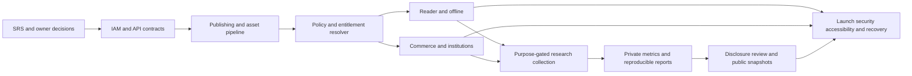

# Reconciliation gaps and dependencies

Updated 2026-10-22. “Open” means the feature or contract is not yet implemented or approved. The database foundation provides physical anchors; it does not close service, security or UX gaps. The IDs below are review IDs and do not replace SRS requirement IDs.

| Gap | SRS IDs | Evidence and missing design or behavior | Required next work | Depends on |
|---|---|---|---|---|
| REC-01 | `FR-PUB-006–007`, `DR-007` | `Publication`/`Edition` lack explicit author/publisher, language, copyright owner, ISBN and provenance fields required by the SRS data dictionary. | Define bibliographic ownership and versioned provenance fields; additive migration and validation tests. | Legal publisher and rights decisions (`DEC-01`). |
| REC-02 | `FR-PUB-005`, `FR-PUB-012–013` | `Chapter` slug is revision-local; `Lesson` has no stable cross-revision content key or annotation equivalence mapping. No errata/diff record exists. | Define stable citation anchors and explicit cross-revision mapping; preserve old anchors. | Editorial version policy. |
| REC-03 | `FR-AST-001–012`, `BR-012`, `SEC-008` | Asset model has hash, scan status and storage key, but lacks per-asset provenance/licence/derived rendition lineage. No quarantine scanner, private object store or delivery service exists. | Define asset evidence/rendition model, scan and conversion pipeline, private delivery tests. | Storage and licence policy (`DEC-01`, `DEC-06`). |
| REC-04 | `FR-ENT-007–013`, `BR-009–011` | `ContentPolicy` stores read/copy/download/print/offline/share and a watermark Boolean; it lacks separate selection, PDF export, screenshot notice mode, watermark identity/copyright and effective-time semantics. | Expand effective action policy contract, inheritance tests and service resolver; use accessible deterrent language. | Publishing and asset scope. |
| REC-05 | `FR-ENT-001–017`, `FR-CAT-005`, `BR-001–004` | Database grant constraints exist, but no server-side object/action resolver, protected reader/file authorization or decision audit exists. | Build a central deny-by-default resolver and authorization matrix with negative tests. | IAM, publication states and policy model. |
| REC-06 | `FR-PAY-001–018`, `BR-007–008`, `INT-006` | Payment tables and idempotency constraints exist; gateway-specific signature, settlement verification, recurring capability, order lifecycle worker and reconciliation queue do not. `PlanVersion` does not carry all displayed trial/renewal terms as structured fields. | Approve provider/terms; define exact DTOs and adapter tests before payment activation. | Owner decisions `DEC-02–04`; entitlements and outbox. |
| REC-07 | `FR-INS-001–013`, `BR-005–006`, `BR-014` | Domain/membership constraints exist, but no proof review workflow, capacity/revalidation worker, roster importer, scoped API guards or manager separation tests exist. `EligibilityPolicy` has no explicit capacity/agreement record. | Define policy/evidence contract and scoped operations; test exact-domain and cross-institution denial. | IAM/roles, owner eligibility decision (`DEC-07`). |
| REC-08 | `FR-RDR-001–012`, `BR-017` | Progress, bookmark and annotation models exist; no protected reader, stable position mapping, private notes authorization, read-aloud or accessibility test exists. | Reader service/PWA with owner-only notes and edition-change tests. | Publishing and entitlement resolver. |
| REC-09 | `FR-LRN-001–012`, `SEC-004` | Quiz/project tables exist, but no rubric-version/feedback/portfolio workflow, sandboxed code lab or isolated server-language runner exists. | Specify grading and sandbox contracts; add tamper and origin-isolation tests. | Reader, authoring and release policy. |
| REC-10 | `FR-OFL-001–012`, `BR-016` | `OfflineLicence` and `SyncOperation` store bounds and dedup IDs; encrypted cache, manifest verification, conflict resolution, revocation-on-reconnect and offline UX are absent. | Define licence/queue DTOs and PWA sync state machine; test replay and expiry. | Reader and entitlement resolver. |
| REC-11 | `FR-OPS-001–010`, `NFR-OPS-005` | `Notification` lacks read state, user channel preference and delivery attempt metadata. The logical design's support ticket, system job, feature flag and access-decision records are absent from Prisma. | Refine operational data model and scoped workflows; add worker retry/dead-letter and alert tests. | IAM, outbox and admin API. |
| REC-12 | `RAI-COL-001–017`, `DR-005–006`, `SEC-014` | Research schemas and event dedup exist; purpose-gated ingestion, strict event schema allowlist, encrypted identity mapping service, retention worker and bot/late-event quality rules do not. | Separate ingest/write/read roles and keys; implement consent and minimisation tests. | Privacy/legal basis and retention decisions (`DEC-08–09`). |
| REC-13 | `RAI-ANA-001–016` | `ResearchReport` stores metric version and snapshot key but not source dataset, transform/query version, output checksum or inclusion/exclusion evidence. Private dashboards/studies/export control are absent. | Define reproducible report manifest and private research MFA/ABAC. | REC-12 and metric dictionary. |
| REC-14 | `RAI-PUB-001–012`, `BR-013`, `BR-018` | Review/snapshot tables exist; public disclosure policy, complementary suppression/differencing engine, distinct approver enforcement, allowlisted public DTOs and cache invalidation do not. | Specify and test release state machine and immutable fixed-shape snapshots. | REC-12/13 and disclosure approval (`DEC-10`). |
| REC-15 | `FR-IAM-001–011`, `SEC-002`, `SEC-005` | Identity tables exist; registration, MFA, session rotation, recovery, throttling, CSRF and enumeration-resistant endpoints are not implemented. OpenAPI omits explicit cookie security for `GET /auth/sessions` and `DELETE /auth/sessions/{id}`. | Refine auth DTOs/security declarations; implement session and negative tests. | API foundation and email provider. |
| REC-16 | `INT-001–010`, `SEC-001`, `SEC-010` | All 102 OpenAPI operations are design-stage. 39 require specific DTOs; Step 1 linked only 40 operations, leaving 62 without a direct source link. The reconciled matrix gives all 102 a proposed SRS anchor, but broad route existence does not prove semantic fit. | Review operation-level input/output/error/authz/tenant scope, link each necessary operation to acceptance tests and deprecate unneeded candidates deliberately. | Module refinement; no application API yet. |
| REC-17 | `NFR-UX-001–010`, `FR-RDR-010` | Prototype supplies six global visual states, but no production loading/empty/error/denied/offline/expired flows or WCAG 2.2 AA evidence. Static case extraction found contextual inbound links for 41 screens; runtime navigation needs manual keyboard review. | Define per-screen state matrix and critical-flow accessibility E2E. | Web PWA and API error contracts. |
| REC-18 | `NFR-OPS-001–010`, `DR-009`, `SEC-006–007` | Isolated database CI passes; staging, API/worker/image gates, deployment runbooks, approved RPO/RTO and timed restore are open. | Add staged environments, secrets, disaster-recovery drill and promotion gates. | Hosting and RPO/RTO decisions (`DEC-05`). |
| REC-19 | `FR-SRC-001–008`, `DR-008` | Search has no implemented index or protected snippet/query filter. Logical source design warns about public cache leakage; no index invalidation path exists. | Define published-only index, object-filtered results and withdrawal tests. | Publishing states, entitlement resolver and worker. |
| REC-20 | `FR-OPS-004`, `SEC-011`, `DR-003` | Append-only `AuditEvent` rows and hashes exist, but an integrity chain/signature and reviewed sensitive before/after diff policy are not established. | Define tamper evidence, retention, redaction and privileged review tests. | Key management, roles and operations. |

## Critical sequence

The full requirement-level acceptance design is in [ACCEPTANCE_CRITERIA.csv](ACCEPTANCE_CRITERIA.csv). A criterion becomes implementation-ready only after module-specific input/output examples, authorized and unauthorized principals, state transitions, boundary values and measurable evidence are approved. Existing eight database constraint tests cover selected physical invariants and are not substitutes for these service and E2E tests.
